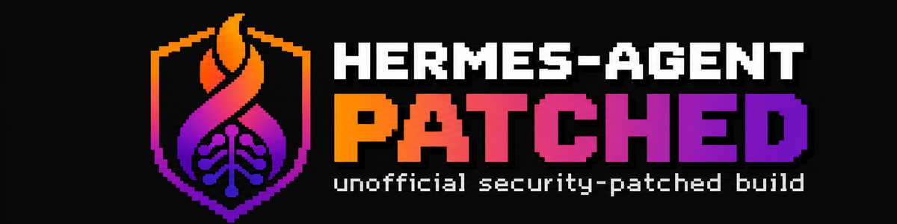

<p align="center"></p>

# hermes-agent-patched

**Unofficial.** The official [Hermes Agent](https://github.com/NousResearch/hermes-agent)
image by Nous Research, rebuilt with security fixes that upstream has not
shipped yet. Same entrypoint, same volumes, same behaviour; use it exactly like
`nousresearch/hermes-agent`. Not affiliated with or endorsed by Nous Research.

```bash
docker pull ghcr.io/cogniflamme/hermes-agent-patched:v0.22.6-patched
# or docker.io/cogniflamme/hermes-agent-patched (same digest)
```

Pin by digest in production; every build is signed (below).

## What changes

Each change names what it fixes and goes away once an upstream release
carries the fix.

| # | Change | Why |
|---|---|---|
| 1 | `apt-get upgrade` from Debian trixie-security | every Debian security fix at build time, e.g. `libbrotli1` 1.1.0-2+deb13u1 (CVE-2026-111497, **CISA KEV**, Brotli decoder overflow) |
| 2 | Bundled Chrome for Testing **145.0.7632.6** → the **newest patched Chromium**: Debian's when it has caught up, else Google's Chrome for Testing pinned in `chrome.env` (**157.0.8103.78** on 2026-11-12, Widevine removed; see NOTICE) | the bundled Chrome (pinned in Hermes' `pm/lock.json`) has ~1,700 known vulnerabilities, four of them **exploited in the wild** (CVE-2026-2441, -87491, -11645, -85046); Debian's Chromium 156 still had CVE-2026-125350 (**CISA KEV**, fixed in 157.0.8103.50). Hermes starts the browser with `--no-sandbox` inside containers, so a malicious page reaches the container. The bundled binaries become links to `/usr/bin/chromium`, and both path files Hermes reads point there; `ci/chrome.py` (daily, in `upstream.yml`) opens the PR when Google publishes a newer stable |
| 3 | Python, pinned by hash: `brotlicffi` 1.2.1.0, `pyasn1` 0.6.5, `tornado` 6.6, `pypdf` 6.21.4, `oauthlib` 4.0.1 | GHSA-9v8h-qqgm-4m35 (**KEV**), 8 High (pyasn1), 7 High (pypdf, v0.22.6), tornado Medium, GHSA-3jp2-3mrg-2vxc High (oauthlib, v0.22.6). Only packages the Hermes release ships are touched |
| 4 | Debian's `docker-cli` 26.1.5 → Docker's `docker-ce-cli` (signed repository) | Debian's build uses Go 1.24.4: 3 Critical, 33 High in the Go standard library |
| 5 | npm 12.0.2 → 12.2.1 (both bundled copies), its `undici` → 6.29.1 | undici (TLS certificate validation bypass, DoS), ip-address, brace-expansion, tar, postcss-selector-parser |
| 6 | Photon platform sidecar: `undici` 7.30.1, `zod` 4.6.6 | 4 High, 1 High |

Nothing else: no configuration, entrypoint or code changes in Hermes.

## Result (v0.22.5, grype, 2026-11-03)

| | upstream | patched |
|---|---|---|
| exploited in the wild (CISA KEV) | 7 | **0** |
| Critical / High **with a fix** | 376 / 1,403 | 1 / 1 (both reviewed exceptions, `ci/accepted.toml`) |
| all findings | 4,605 | 1,468 |

What remains has no fix anywhere yet: mostly Debian packages Debian marks
"won't fix" or "not fixed yet" (curl, libxml2, the system Python 3.13 that
Hermes does not use) and nothing from Chromium while Chrome for Testing
bridges Debian's delay. The weekly rebuild takes Debian's fixes as they land.

## Patched, not hardened

The image fixes known vulnerabilities; it does not restrict what Hermes can
do. That part is how you run it. These settings were tested with this image
(boot, crash restart, the PDF skill, Chromium and the browser tool, npm/uv
installs, Matrix) and change nothing Hermes needs: Hermes itself already runs
as uid 10000, and only its supervisor and setup script run as root.

```bash
docker run --read-only --tmpfs /run:exec --tmpfs /tmp:exec,size=1g --shm-size 1g \
  --security-opt no-new-privileges \
  --cap-drop ALL --cap-add CHOWN --cap-add DAC_OVERRIDE --cap-add FOWNER \
  --cap-add KILL --cap-add SETUID --cap-add SETGID \
  -v hermes-data:/opt/data ghcr.io/cogniflamme/hermes-agent-patched:latest gateway run
```

Docker's `--tmpfs` defaults to `noexec` and 64 MB, which s6 (it runs scripts
from `/run`) and Chromium do not survive, hence `exec` and the size. Tested
with Podman, where `--read-only` already mounts `/run` and `/tmp`; Quadlet:
`ReadOnly=true`, `NoNewPrivileges=true`, `DropCapability=ALL`,
`AddCapability=CHOWN DAC_OVERRIDE FOWNER KILL SETUID SETGID`. Only
`/opt/data` (and any volume you add) stays writable.

## Verify an image

```bash
# Signature: built by this repository's workflow, on main
cosign verify ghcr.io/cogniflamme/hermes-agent-patched@sha256:<digest> \
  --certificate-oidc-issuer https://token.actions.githubusercontent.com \
  --certificate-identity-regexp '^https://github.com/cogniflamme/hermes-agent-patched/\.github/workflows/build\.yml@refs/heads/main$'

# Build provenance (SLSA), signed by GitHub
gh attestation verify oci://ghcr.io/cogniflamme/hermes-agent-patched@sha256:<digest> \
  --repo cogniflamme/hermes-agent-patched

# SBOM (SPDX, per architecture), stored with the image by BuildKit
docker buildx imagetools inspect ghcr.io/cogniflamme/hermes-agent-patched:latest \
  --format '{{ json .SBOM }}'
```

## How it is built

- **Every push, PR, weekly (Monday) and on demand**, for amd64 and arm64 on
  native runners: build → push the untagged digest → pull it back →
  `tests/run.sh` (versions, tools, boot, the browser tool end to end against
  a local page, and `tests/functional.sh`: the code paths that use the
  updated packages, i.e. Hermes' PDF skill on pypdf, brotli responses through
  httpx/urllib3, google-auth on pyasn1, tornado, Chromium on real sites,
  npm/npx) → grype → `ci/gate.py`.
- **The gate fails** on any CISA KEV finding, and on any Critical/High
  finding that has a fix, unless `ci/accepted.toml` lists it with a reason
  and an expiry date.
- **Only if every architecture passes** does `publish` tag the multi-arch
  index (`vX.Y.Z-patched.YYYYMMDD`, `vX.Y.Z-patched`, `latest`), sign it
  with cosign (keyless, Sigstore) and attest SLSA build provenance. Each
  architecture also carries BuildKit's SPDX SBOM and provenance, and the
  run keeps the full SBOM as a downloadable artifact.
- **Upstream releases**: a daily job opens a PR moving `upstream.env` to the
  newest stable Hermes once it is 2 days old, and builds it. A person merges.
- **Repo hygiene**: actions pinned by commit SHA (Dependabot keeps them
  current), least-privilege tokens per job, actionlint + zizmor + shellcheck
  + hadolint, OpenSSF Scorecard.

Local: `make build test scan` (podman or `ENGINE=docker`, grype).

## Dropping a patch

When a Hermes release ships a fix, remove its block from the Containerfile
(and its line here). The gate shows whether anything is still found without
it; `patches/select.py` already skips Python packages a release no longer
has or has already fixed.

## License

The scripts and Containerfile here: MIT (LICENSE). The image contains Hermes
Agent (MIT, © Nous Research), Debian packages, and Debian's Chromium or Google's
Chrome for Testing (Google's terms), each under its own license; see NOTICE. The banner (`assets/banner.png`) carries the Cogniflamme
Labs logo and is not covered by the MIT license: please do not reuse it.
